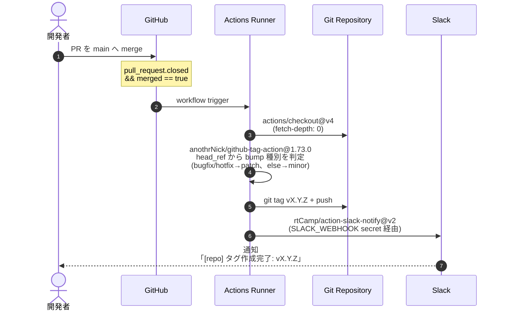

# GitHub Actions

このプロジェクトで動いている GitHub Actions ワークフロー一覧と、それぞれの動作・設定。

## ワークフロー一覧

| 名前 | ファイル | 発火条件 | 役割 |
|---|---|---|---|
| **`CI`** | [`.github/workflows/ci.yml`](../../.github/workflows/ci.yml) | PR / `main` への push | PHP テスト + フロントのビルド + PostgreSQL でのマイグレーション + ワークフローの検査 |
| **`Claude Code Review`** | [`.github/workflows/claude-code-review.yml`](../../.github/workflows/claude-code-review.yml) | PR を開いた / draft を ready にした / コメントに `@claude` | `.claude/agents/` のサブエージェントで PR をレビューし、inline comment を付ける |
| **`【_auto】Create git tag`** | [`.github/workflows/create_git_tag.yml`](../../.github/workflows/create_git_tag.yml) | `main` への PR が **merge** されたとき | 自動 version bump + tag push + Slack 通知 |
| **`ECR push`** | [`.github/workflows/aws-ecr-push.yml`](../../.github/workflows/aws-ecr-push.yml) | 手動 (`workflow_dispatch`) | イメージをビルドして ECR へ push |
| **`AWS OIDC connection test`** | [`.github/workflows/aws-oidc-connection-test.yml`](../../.github/workflows/aws-oidc-connection-test.yml) | 手動 (`workflow_dispatch`) | OIDC で AssumeRole できるかの疎通確認 |

---

## `【_auto】Create git tag`

### 概要

`main` ブランチに PR が merge されたら、以下を自動実行する:

1. 直近の git tag を取得 (なければ `INITIAL_VERSION: v0.1.0` から開始)
2. PR のブランチ名から bump 種別を判定
3. 新しい tag を push
4. Slack に結果を通知

GitHub の Releases ページから **手動でリリースを作る必要はない**。
初回 merge で `v0.1.0` が自動で打たれる。

### シーケンス



### bump ルール

| PR ブランチ名 (`head_ref`) | bump | 例 |
|---|---|---|
| `bugfix` を含む | patch | `v0.2.0` → `v0.2.1` |
| `hotfix` を含む | patch | `v0.2.0` → `v0.2.1` |
| それ以外 (`feature/*` など) | minor | `v0.2.0` → `v0.3.0` |

major bump (`v1.0.0` → `v2.0.0`) は現状自動化されていない。必要なら手動で tag を切る。

### 必要な GitHub Secrets

| Secret 名 | 用途 | 設定方法 |
|---|---|---|
| `GITHUB_TOKEN` | tag push 用 | 自動でセットされる (設定不要) |
| `SLACK_WEBHOOK` | Slack Incoming Webhook URL | `gh secret set SLACK_WEBHOOK` で登録 |

```bash
# Slack Webhook の登録
echo "https://hooks.slack.com/services/T.../B.../..." | gh secret set SLACK_WEBHOOK

# 登録確認
gh secret list
```

### 必要な permissions

```yaml
permissions:
  contents: write   # tag push に必要 (GitHub Actions のデフォルトは read)
```

### Slack 通知のフォーマット

| 結果 | 色 | メッセージ |
|---|---|---|
| 成功 | 紫 (`#4834d4`) | `タグ作成完了: vX.Y.Z` |
| 失敗 | 赤 (`#dc3545`) | `タグ作成に失敗しました` |

通知先チャンネルは Incoming Webhook 側の設定に従う (`SLACK_CHANNEL` 未指定)。

### トラブルシューティング

| 症状 | 原因 | 対処 |
|---|---|---|
| tag が push されない | `permissions.contents: write` が無い | workflow に追記 |
| Slack 通知が来ない | `SLACK_WEBHOOK` 未登録 / URL 失効 | `gh secret set SLACK_WEBHOOK` で再登録 |
| 既存 tag と同じ番号で止まる | bump 計算が `none` になっている | `DEFAULT_BUMP` の判定式を見直す |
| 同じ merge で workflow が再発火 | merge 後にリトライした | actions の history を確認、通常は問題なし |

### Webhook URL を再生成したいとき

何らかの理由で Webhook URL を漏洩させた場合:

```
1. Slack の App 設定 (https://api.slack.com/apps) で対象 App を開く
2. Incoming Webhooks から 該当 URL を Remove → Add New Webhook で再発行
3. gh secret set SLACK_WEBHOOK で新 URL を登録
```

---

## `CI`

PR と `main` への push で走る。**ここが緑にならないと `main` へ入れない**、という土台。

| ジョブ | 中身 |
|---|---|
| **PHP テスト** | composer / npm の依存 → Vite ビルド (`@vite()` が manifest を参照するため) → **PostgreSQL で `migrate:fresh`** → `php artisan test` |
| **ワークフローの検査** | `actionlint` (構文・式・非推奨コマンド・`run:` の shellcheck) と `zizmor` (固定漏れ・コード注入・過剰な permissions) |

⚠ **テスト本体は SQLite の in-memory** (`src/phpunit.xml` が上書きする)。
実 PostgreSQL を立てているのは **マイグレーションのため** だけ。SQLite だけで確かめると、
識別子の 63 文字上限による «静かな切り詰め → 索引名の衝突» のように
PostgreSQL でしか落ちない書き方が緑のまま入る (CLAUDE.md §12)。

⚠ **`.env.example` をコピーしているだけ**なので、env に依存する分岐は
«空の値のまま一度も評価されず» 緑になる。env で挙動が変わるところは、
テストの中で `config([...])` に明示的に入れてから確かめること。

### action の固定方針

`.github/zizmor.yml` に書いてある。

- **GitHub / AWS / Docker の公式** (`actions/*` / `aws-actions/*` / `docker/*`) … tag のまま
- **それ以外** … **SHA で固定** + `# v1.2.3` のように版のコメントを添える

サードパーティは作者のアカウントが取られれば tag を同じ名前のまま差し替えられるので、
«差し替えを検知する» のではなく «差し替えても効かない» ようにする。
固定したまま更新が止まらないよう、`.github/dependabot.yml` が SHA を差し替える PR を出す。

⚠ `run:` の中の docker image (actionlint / zizmor) は `uses:` ではないので
Dependabot も zizmor も追わない。**digest で固定し、版のコメントと対で差し替える**。

---

## `Claude Code Review`

`.claude/agents/` のサブエージェントで PR をレビューし、inline comment を付ける。
指摘の中身は各エージェントの定義が持ち、ワークフローは
**起動条件と差分の渡し方** だけを決める (振り分けは `.claude/skills/review-pr/`)。

- 走るのは **人が「見てくれ」と言った瞬間だけ** (PR を開いた / draft を ready にした /
  コメントに `@claude`)。push では走らせない
- **`ANTHROPIC_API_KEY` が未登録なら、notice を出して緑で終わる**
  (未登録で赤くなると誰も直さないまま放置されるため)

```bash
gh secret set ANTHROPIC_API_KEY
```

⚠ サブエージェントに **Bash を一切渡していない**。
`git diff --no-index /dev/null <パス>` で任意のファイルが読め、
`git diff --output=<パス>` で書き込みまでできるため。
差分と PR 本文は前段のステップが `.claude-review/` に落としてある。

---

## 今後追加候補

| ワークフロー案 | 用途 |
|---|---|
| `lint.yml` | Pint (Laravel 標準 PHP-CS-Fixer) + Larastan で静的解析 |
| `deploy.yml` | tag を切ったら本番にデプロイ |
| `create_github_release.yml` | tag に紐づく GitHub Release を自動生成 (リリースノート付き) |

必要になったタイミングで追加する。
